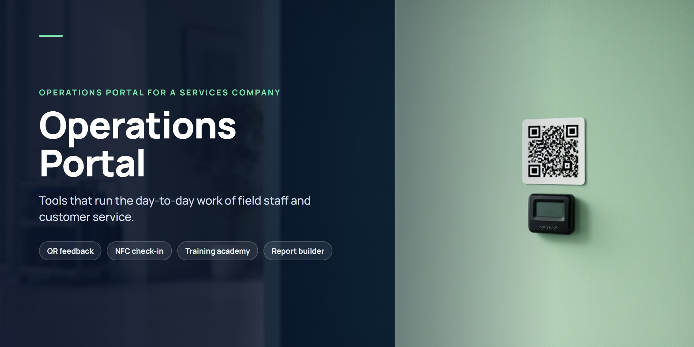
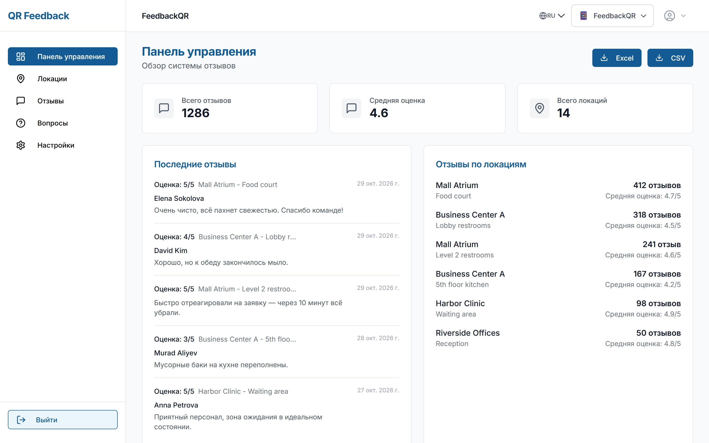
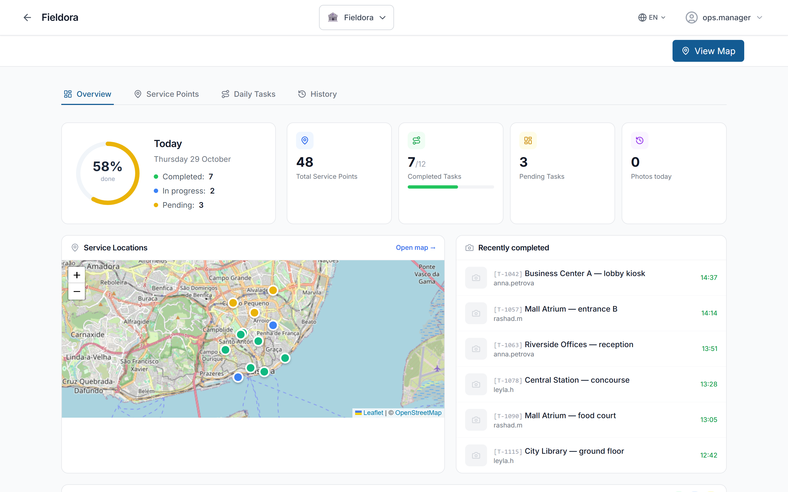
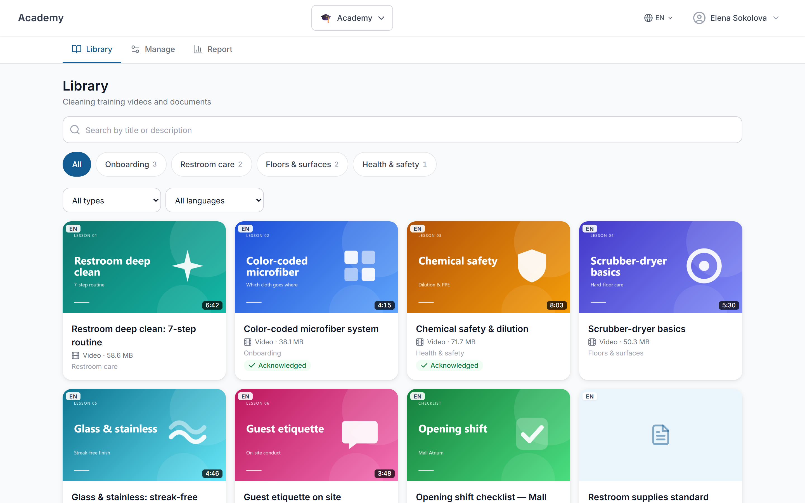
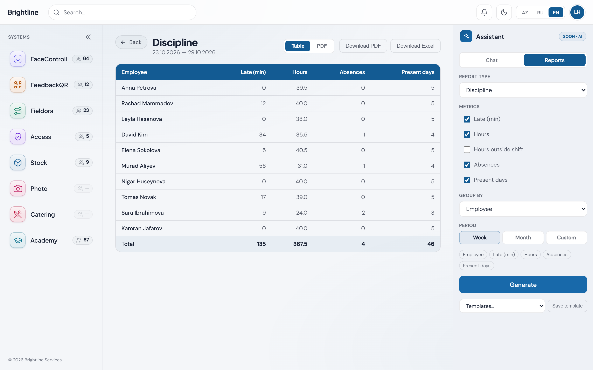
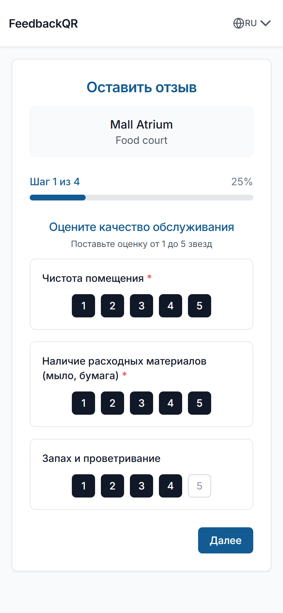

  

# Operations Portal

**A set of tools that runs the day-to-day work of field staff and customer service** at a services company — one portal with a single sign-in for managers, supervisors and staff on site.

## Who it's for

Facility-services, cleaning and other field-service companies with many service points (business centres, malls, clinics, offices) and staff spread across them.

## Key features

- **Customer feedback through QR stickers.** Each service point has its own QR sticker; visitors rate the service in a short mobile form, and managers see reviews and ratings by location, with export to Excel and CSV.
- **Staff check-in on site.** Staff check in at service points by NFC tag and location; managers see today's tasks, completions and check-ins on a map.
- **Training academy.** A library of training videos and documents by topic and language, with tracking of who has watched and acknowledged each one.
- **Report builder.** Managers pick metrics, grouping and period and get a ready report — table, PDF or Excel — without a developer.
- **One portal for all modules.** Single sign-in, roles and access, three interface languages.

## Platforms

Web portal for managers and supervisors; mobile web for staff on site and for customers scanning QR codes. Interface in English, Russian and Azerbaijani.

## Screenshots

All screenshots use demo data with fictitious locations and people.

**QR feedback dashboard** — reviews from QR stickers at service points, ratings by location.

**Field operations** — today's tasks on a map, with completions stamped by staff check-in.

**Training academy** — video library with sections, durations and acknowledgement tracking.

**Report builder** — a manager picks metrics, grouping and period and gets a ready report.

<table>
  <tr>
    <td width="320"></td>
    <td><b>Mobile review form</b> — what a customer sees after scanning a QR sticker at a service point.</td>
  </tr>
</table>

## Stack

Python (FastAPI) · Node.js / TypeScript · React · PostgreSQL · Docker · Nginx

## Source code

Source code is private — demo on request.

## Contact

Zulfi Aliyev · alliyev.zulfi95@gmail.com · [sci-fi.az](https://sci-fi.az) · [LinkedIn](https://www.linkedin.com/in/zulfi-aliyev/)
